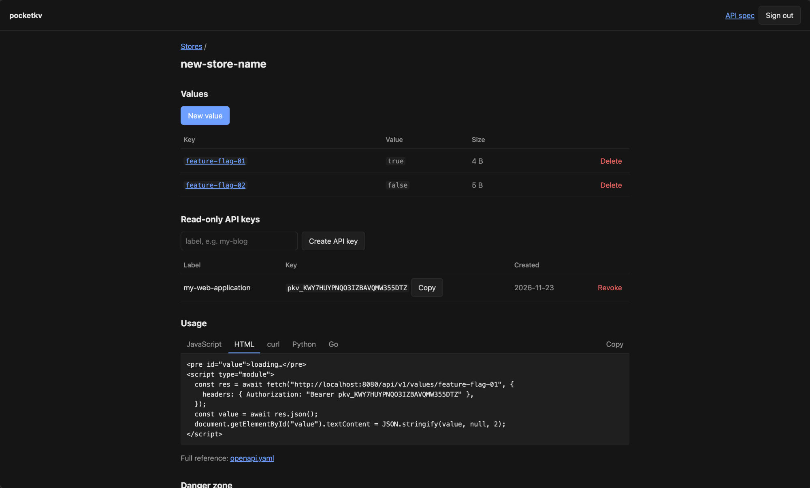

# pocketkv

Simple minimal self hostable kv datastore you can use to serve dynamic read-only values to static sites.



## Deploy

Requires Docker.

```sh
git clone https://github.com/katistix/pocketkv.git && cd pocketkv
cp .env.example .env   # set DASHBOARD_USER and DASHBOARD_PASSWORD
./deploy.sh
```

Runs on port 8080 (set `PORT` in `.env` to change it). Data is kept in the `pocketkv-data` Docker volume.

Update: `git pull && ./deploy.sh`

## API

```sh
curl -H "Authorization: Bearer pkv_..." https://your-host/api/v1/values/my-key   # one value
curl -H "Authorization: Bearer pkv_..." https://your-host/api/v1/values          # all values
```

Full spec at `/openapi.yaml`.

## Development

```sh
cp .env.example .env
go run ./cmd/pocketkv
```
